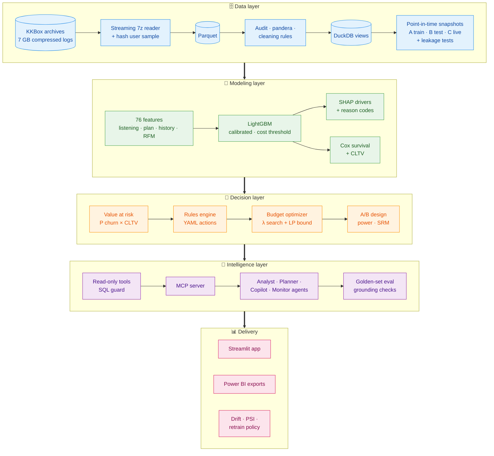
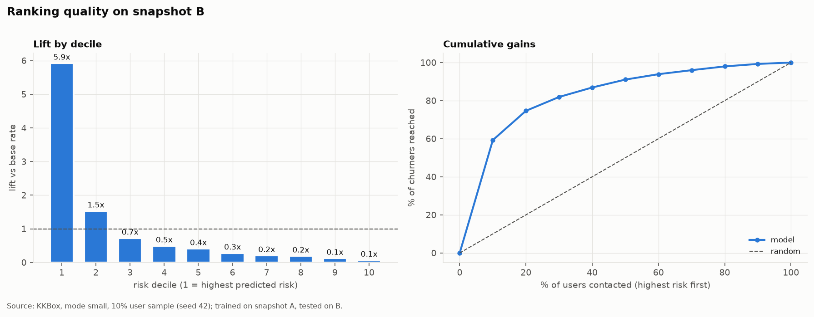
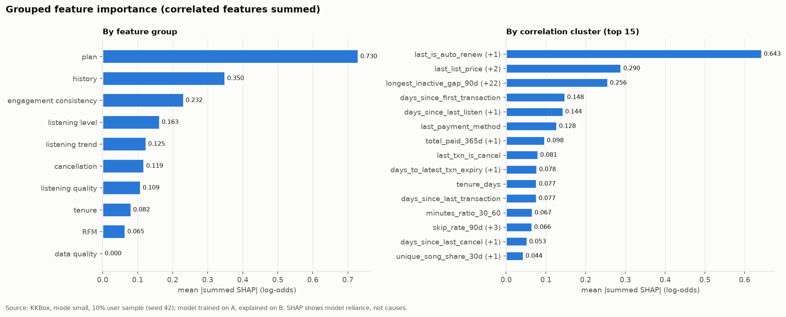
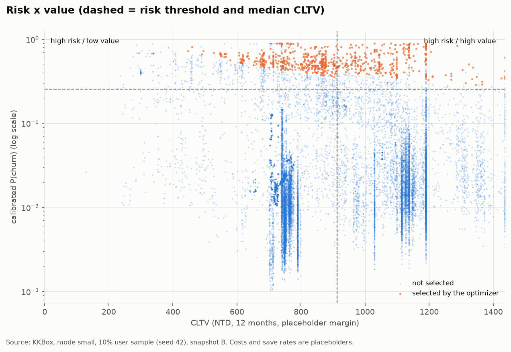

<div align="center">

# 🎧 ChurnLens

**Churn prediction & retention intelligence for KKBox music-streaming subscribers**

*Who will churn → why → how much they're worth → what to do about it*

[](https://github.com/LokeshMaan10/ChurnLens/actions/workflows/ci.yml)


</div>

---

## ✨ Highlights

| | |
|---|---|
| 🎯 **5.9× lift** | in the top risk decile; the riskiest 10% of users holds ~59% of all churners |
| 📈 **PR-AUC 0.574 · ROC-AUC 0.873** | on an *out-of-time* month the model never saw |
| 🛡️ **Leakage-tested** | train on Feb 2017, test on Mar 2017, automated leakage tests |
| 💰 **Value-aware targeting** | churn risk × survival-based CLTV → budget optimizer |
| 🤖 **Grounded AI agents** | read-only MCP tools; 100% on a 45-question golden set, 15/15 safety tests |

## 🏗️ Architecture



## 📊 Results

<!-- BEGIN:readme_results -->
_Generated by `python -m churnlens.docsgen` from pipeline outputs. Data: small mode, 10% user sample (seed 42). Full detail: [`reports/results.md`](reports/results.md)._

| Result | Value |
|---|---|
| Users (train A / test B) | 99,340 / 97,237 |
| Churn rate (A / B) | 6.42% / 9.09% |
| Selected model | lightgbm (chosen on A only) |
| PR-AUC / ROC-AUC on out-of-time B | 0.574 / 0.873 |
| Churners caught in the riskiest 5% of B | 39.5% (precision 71.8%) |
| CLTV method (lower backtest error) | survival |
| Optimizer expected net benefit (placeholder costs) | 259,685 NTD |
| Prediction drift A → B (PSI) / retrain verdict | 0.019 / retrain |
| Agent golden set (offline mode): numeric / SQL / grounded | 100% / 100% / 100% (45 analyst questions) |
| Agent safety tests passed | 15/15 |
<!-- END:readme_results -->

### Ranking quality: who to contact first


### What drives churn risk (SHAP: model reliance, not causes)


### Who gets targeted: risk × value


## 🧰 Tech stack

| Layer | Tools |
|---|---|
| Data | DuckDB · Parquet/PyArrow · pandera · py7zr streaming |
| ML | LightGBM · scikit-learn · SHAP · lifelines · MLflow |
| Decisioning | YAML rules engine · LP optimizer · SciPy stats |
| AI | MCP server · Claude-ready agents (offline mode by default) |
| Delivery | Streamlit · Power BI · Evidently · Docker · GitHub Actions |

## 🚀 Quick start

```bash
python -m venv .venv && .venv/Scripts/pip install -e ".[dev]"
make data        # stream + sample the KKBox archives (rules accepted on Kaggle)
make pipeline    # clean → snapshots → features → model → value → optimizer
make app         # http://localhost:8501
```

Or with Docker: `docker compose up --build`.

> **Note:** results use a 10% user sample, and the money figures use placeholder costs. The data is not redistributed; download it from the [Kaggle competition](https://www.kaggle.com/c/kkbox-churn-prediction-challenge).

<sub>Full results: [`reports/results.md`](reports/results.md) · Design decisions: [`docs/decisions.md`](docs/decisions.md)</sub>
