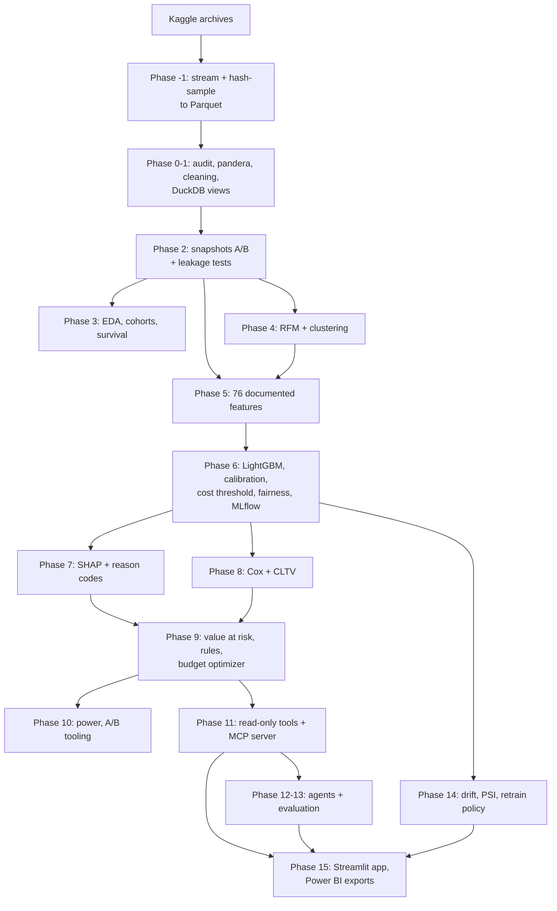

# ChurnLens

Customer churn prediction and retention intelligence on the KKBox churn dataset (WSDM Cup
2018). ChurnLens answers four questions: **who** is likely to churn, **why** (as
associations, not causes), **how valuable** they are, and **what to do** — with an agent layer
on top.

## Architecture



Snapshot A (February 2017 expirations) is used for every modelling choice; snapshot B (March)
is the out-of-time test; snapshot C (April) is scored live from scoring-only logs.

## Results

<!-- BEGIN:readme_results -->
_Generated by `python -m churnlens.docsgen` from pipeline outputs. Data: small mode, 10% user sample (seed 42). Full detail: [`reports/results.md`](reports/results.md)._

| Result | Value |
|---|---|
| Users (train A / test B) | 99,340 / 97,237 |
| Churn rate (A / B) | 6.42% / 9.09% |
| Selected model | lightgbm (chosen on A only) |
| PR-AUC / ROC-AUC on out-of-time B | 0.574 / 0.873 |
| Churners caught in the riskiest 5% of B | 39.5% (precision 71.8%) |
| CLTV method (lower backtest error) | survival |
| Optimizer expected net benefit (placeholder costs) | 259,685 NTD |
| Prediction drift A → B (PSI) / retrain verdict | 0.019 / retrain |
| Agent golden set (offline mode): numeric / SQL / grounded | 100% / 100% / 100% (45 analyst questions) |
| Agent safety tests passed | 15/15 |
<!-- END:readme_results -->

The complete, code-generated results are in [`reports/results.md`](reports/results.md);
design decisions with reasons in [`docs/decisions.md`](docs/decisions.md); an interview-style
summary in [`reports/interview_walkthrough.md`](reports/interview_walkthrough.md).

## Setup

Requirements: Python 3.11, the Kaggle competition archives (rules accepted), ~10 GB disk.

```bash
py -3.11 -m venv .venv
.venv/Scripts/python -m pip install -e ".[dev]"
.venv/Scripts/python -m pre_commit install
```

Place the `.7z` archives in `data/raw/_downloads/` (or put a Kaggle token at
`~/.kaggle/kaggle.json` and let `make data` download them), then build everything in order:

```bash
make data          # Phase -1: stream, sample, Parquet + MANIFEST
make pipeline      # Phases 0-10 (the model step takes ~30 min in small mode)
make explain       # Phase 7 SHAP (~15 min)
make monitor       # Phase 14 drift + incident note
make live-score    # April scoring demo
make agent-eval    # Phase 13
make exports docs  # Power BI tables, README results, walkthrough
make app           # Streamlit at http://localhost:8501
```

Without `make` (Windows), run the command under each target in the `Makefile` directly.
`configs/data.yaml` switches between `mode: small` (10% user sample) and `mode: full`.

**Agents** run offline (free, deterministic) by default. To use Claude instead, set
`ANTHROPIC_API_KEY` and `CHURNLENS_MODEL` (the model id is read from that variable). **MCP**:
`python -m churnlens.mcp_server.server` serves the read-only tools over stdio.

**Docker**: `docker compose up --build` runs the app (port 8501) and the MCP server over HTTP
(port 8000), mounting `data/`, `models/` and `reports/`.

## Repository layout

```
configs/      every parameter (data, cleaning, features, model, costs, rules, monitoring, …)
src/churnlens/
  data/ snapshots/ features/ analysis/ segmentation/ modeling/ explain/ value/
  prioritize/ experiments/ monitoring/ tools/ mcp_server/ agents/ evals/ scoring/
app/          Streamlit app
tests/        unit, leakage, data, agent, app tests
reports/      results.md, figures, tables, walkthrough
docs/         decisions, data dictionary, cleaning rules, agent design, Power BI guide
```

## Limitations

- Results come from a 10% user sample (small mode); the full run has not been executed.
- Costs, save rates and margin are **placeholders**; every money figure depends on them.
- Observational data: nothing here measures what an action changes. The A/B and uplift
  results are **simulated** demonstrations of the tooling.
- Calibrated probabilities ran low on the test month; the retraining policy fires.
- `days_since_first_transaction` tracks the calendar (history starts January 2015); it should
  be capped or re-anchored before retraining.
- Snapshot B labels agree less with the rebuilt churn rule than snapshot A's (the 30-day
  window runs past the data's end).
- The Claude-backed agent mode was built but **not run** (no API key); the offline agents were
  evaluated. The offline analyst is template-based.
- Docker images were written but not built here (Docker Desktop was not running).

## Future work

- Run `mode: full`; replace placeholder costs with finance figures and measured save rates.
- Re-anchor clock features, retrain, and recalibrate on recent data.
- Run the designed randomized retention test; fit uplift models on real treatment data.
- Evaluate the Claude-backed agents on the golden set (accuracy, latency, token cost).
